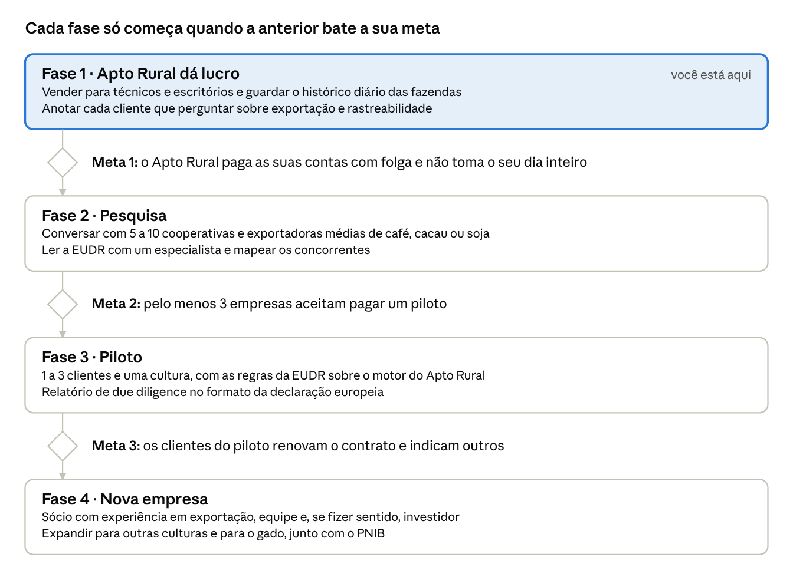

# Proposta de startup: origem comprovada para exportação do agro

27/10/2026 · André

> Plano para o futuro, depois que o Apto Rural der lucro. Versão editável (com comentários) em [Claude Docs](https://claude.ai/artifact/8CuZVMQJ9y7H4K46uTnRxx). Este arquivo é uma cópia salva no repositório.

## Resumo

Uma plataforma que prova, fazenda por fazenda e lote por lote, que soja, carne, café e cacau vêm de área sem desmatamento e sem impedimentos legais. Quem paga são as empresas que compram e exportam essa produção.

É o segundo passo depois do Apto Rural. O mesmo motor que hoje checa uma fazenda para o crédito rural passa a checar milhares de fornecedores para a exportação. O cliente deixa de ser o técnico, que paga R$ 199 por mês, e passa a ser a trading, o frigorífico ou a cooperativa, com contratos muito maiores.

Esta proposta só começa depois que o Apto Rural der lucro e trouxer contatos no agro (veja *Quando começar*).

## O problema

A partir de 30/12/2026, quem vende soja, carne, café ou cacau para a União Europeia precisa provar a origem de cada lote. Pela lei europeia contra desmatamento (EUDR), cada lote precisa mostrar:

- **Onde foi produzido:** a localização de cada fazenda de origem.
- **Que a área não foi desmatada** depois da data de corte da lei (31/12/2020).
- **Que a produção seguiu as leis do país de origem**, como as ambientais, as trabalhistas e as de terras indígenas.

| Quem | Desde quando |
| --- | --- |
| Empresas grandes e médias | 30/12/2026 |
| Micro e pequenas empresas | 30/06/2027 |

A lei já foi adiada mais de uma vez. Em maio de 2026, a Comissão Europeia confirmou que a data de dezembro de 2026 fica mantida e que a simplificação virá por regras complementares, sem reabrir a lei.

No Brasil, a pressão vem também de dentro. O governo lançou em dezembro de 2024 o plano de identificação individual de bovinos e búfalos (PNIB), com meta de rastrear cada animal até 31/12/2032. Frigoríficos e compradores também têm acordos próprios contra a compra de gado de área desmatada.

**A dor:** uma trading ou um frigorífico compra de milhares de fazendas e intermediários. Checar cada uma à mão, todo dia, é caro e sujeito a erro. Um lote reprovado na Europa é prejuízo e dano à marca.

*Datas conferidas em 27/10/2026 pelos resultados de busca listados em Fontes. Os produtos cobertos, a data de corte e as obrigações são de conhecimento geral sobre a lei e devem ser conferidos no texto oficial antes de qualquer decisão.*

## A solução

Um sistema em que o cliente cadastra seus fornecedores uma vez e recebe, para cada lote, um relatório pronto para a declaração europeia. Ele tem cinco partes:

1. **Cadastro de fornecedores:** o cliente envia a lista de fazendas (código do CAR e contorno) por planilha ou integração com o sistema dele.
2. **Checagem diária:** cada fazenda é cruzada todos os dias com as bases oficiais, como o Apto Rural já faz: desmatamento, embargo, terra indígena, unidade de conservação e trabalho escravo. A diferença é a data de corte de 31/12/2020, a da lei europeia.
3. **Lote rastreado:** cada carga é ligada às fazendas de onde veio, com a fotografia da checagem no dia da compra.
4. **Relatório de due diligence:** os dados no formato que a declaração europeia pede, com mapa, fontes e datas, verificável por QR, como o dossiê do Apto Rural.
5. **Alertas:** se um fornecedor mudar de situação, o cliente sabe no mesmo dia e bloqueia novas compras dele.

O ponto mais difícil, e o mais valioso, é o **fornecedor indireto**: o boi que passou por outras fazendas antes de chegar ao frigorífico. Resolver isso, por exemplo com os dados de trânsito animal e do PNIB, seria um diferencial forte.

## Quem paga

O melhor primeiro cliente é o exportador médio: precisa cumprir a lei, mas não tem equipe própria para construir o sistema.

| Cliente | Por que precisa | Facilidade de vender |
| --- | --- | --- |
| Cooperativas e exportadoras médias de café e cacau | Vendem muito para a Europa e têm muitos produtores pequenos | Alta: primeiro alvo |
| Cooperativas de grãos | Juntam a soja de centenas de associados | Alta |
| Frigoríficos médios | EUDR, acordos contra desmatamento e o PNIB | Média: o fornecedor indireto é difícil |
| Tradings e frigoríficos grandes | Volume enorme | Baixa no começo: muitos já têm sistema próprio ou fornecedor |
| Importadores europeus | São os responsáveis legais pela declaração | Média: exige vender fora do Brasil |

O caminho natural vai de cima para baixo na tabela: começar com cooperativas e exportadoras médias e chegar aos grandes com casos de sucesso na mão.

## Como o Apto Rural leva até aqui

Boa parte do sistema já existe no Apto Rural. Falta adaptar a regra, o formato do relatório e a escala.

| Já existe no Apto Rural | Vira na nova empresa | O que falta |
| --- | --- | --- |
| Motor de regras do MCR | Motor de regras da EUDR | Data de corte 31/12/2020 e regras de legalidade da lei europeia |
| Bases oficiais no PostGIS, atualizadas todo dia | As mesmas bases | Desmatamento por satélite fora da Amazônia (Cerrado, Mata Atlântica) |
| Carteira com reconferência diária | Monitoramento de fornecedores | Escala de centenas para dezenas de milhares de fazendas |
| Consulta em lote por planilha | Cadastro de fornecedores | Integração com sistemas de compra (API) |
| Dossiê com mapa, fontes e QR | Relatório de due diligence | Formato da declaração europeia, em inglês |
| Histórico de resultados | Prova do que se sabia no dia da compra | Ligação entre lote e fazendas |
| Relação com técnicos e cooperativas | Porta de entrada para os primeiros clientes | Contatos com exportadores |

O ativo mais difícil de copiar é o histórico: anos de checagens diárias de milhares de fazendas, guardadas com data e fonte.

## Modelo de negócio

O modelo é uma assinatura anual por empresa, com o preço subindo conforme o número de fornecedores monitorados.

- **Assinatura anual:** contrato por empresa, cobrado por faixa de fornecedores monitorados (por exemplo, até 500, até 5 mil, acima disso).
- **Implantação:** taxa única para importar a base de fornecedores e integrar com o sistema de compras do cliente.
- **Relatórios por lote:** incluídos numa franquia mensal, com cobrança extra acima dela.
- **Serviços extras:** análise de imagem de satélite em casos duvidosos e apoio para regularizar fornecedores reprovados.

A diferença para o Apto Rural está no tamanho do contrato. Um único cliente pode valer o mesmo que dezenas de técnicos assinantes. Em troca, a venda é mais lenta (meses), exige reuniões, contrato formal e suporte dedicado.

**Pergunta em aberto:** quanto os exportadores médios pagam hoje por esse serviço, ou quanto gastam fazendo à mão. Os preços só devem ser definidos depois de conversar com 5 a 10 deles.

## Concorrência e diferencial

O mercado já tem players públicos e privados. O espaço está no exportador médio, com um serviço pronto, simples e verificável.

| Quem | O que é | Como competir |
| --- | --- | --- |
| [Agro Brasil + Sustentável](https://www.theagribiz.com/agronegocio/governo-lanca-app-para-atender-exigencias-da-ue-nas-exportacoes-agricolas/) (governo, Serpro e Ministério da Agricultura) | Ferramenta gratuita e voluntária para o produtor, que reúne bases públicas num atestado de conformidade | Usar como fonte, não como rival: ela atende o produtor, e o cliente aqui é o comprador com milhares de fornecedores |
| Embrapa Trace (Embrapa) | Protocolo público de rastreabilidade, ainda em construção | Seguir o protocolo quando sair, para conversar com o resto do mercado |
| Empresas de dados e geomonitoramento do agro | Monitoramento socioambiental para bancos, tradings e frigoríficos grandes | Atender quem é pequeno demais para elas, com preço e implantação mais simples |
| Plataformas estrangeiras de EUDR | Ferramentas globais de due diligence | Conhecer as bases e as regras brasileiras melhor que elas |
| Planilha e consultoria | O jeito manual de hoje | Custar menos que a hora de quem faz à mão |

**Diferenciais possíveis:**

- Regras brasileiras aplicadas com a norma citada, como já faz o Apto Rural.
- Histórico diário guardado, que prova o que se sabia no dia da compra.
- Preço e implantação acessíveis para cooperativas e exportadores médios.

*O mapa de concorrentes privados ainda está incompleto e precisa de uma pesquisa própria antes de começar.*

## Riscos

O maior risco é a lei mudar ou ser adiada de novo. O segundo é a plataforma gratuita do governo cobrir o que o cliente precisa.

| Risco | O que fazer |
| --- | --- |
| A EUDR é adiada ou enfraquecida de novo | Não depender só dela: vender também para acordos contra desmatamento, PNIB e exigências de compradores de outros países |
| A plataforma do governo resolve o básico de graça | Focar no que ela não faz: milhares de fornecedores, histórico, integração e alertas para o comprador |
| Venda lenta para empresas grandes | Começar por cooperativas e exportadores médios, que decidem mais rápido |
| Fornecedor indireto (gado) difícil de rastrear | Começar por café, cacau e soja; entrar em gado quando o PNIB avançar |
| Responsabilidade por um lote reprovado na Europa | Contratos revisados por advogado, deixando claro que o sistema apoia a due diligence, mas não a substitui |
| Exige equipe e dinheiro | Só começar com o Apto Rural pagando as contas, e buscar investidor ou sócio com experiência em exportação |
| Dados de desmatamento fora da Amazônia são menos completos | Mapear cedo as bases oficiais do Cerrado e da Mata Atlântica (Prodes por bioma, MapBiomas) |

## Quando começar

A nova empresa só começa quando o Apto Rural pagar as suas contas. Cada fase seguinte só abre quando a anterior bate a sua meta.

1. **Fase 1 · Apto Rural dá lucro** (você está aqui): vender para técnicos e escritórios e guardar o histórico diário das fazendas; anotar cada cliente que perguntar sobre exportação e rastreabilidade.
    - **Meta 1:** o Apto Rural paga as suas contas com folga e não toma o seu dia inteiro.
2. **Fase 2 · Pesquisa:** conversar com 5 a 10 cooperativas e exportadoras médias de café, cacau ou soja; ler a EUDR com um especialista e mapear os concorrentes.
    - **Meta 2:** pelo menos 3 empresas aceitam pagar um piloto.
3. **Fase 3 · Piloto:** 1 a 3 clientes e uma cultura, com as regras da EUDR sobre o motor do Apto Rural; relatório de due diligence no formato da declaração europeia.
    - **Meta 3:** os clientes do piloto renovam o contrato e indicam outros.
4. **Fase 4 · Nova empresa:** sócio com experiência em exportação, equipe e, se fizer sentido, investidor; expandir para outras culturas e para o gado, junto com o PNIB.

As metas são o que importa, não as datas. Se a EUDR for adiada de novo, as fases 1 e 2 seguem iguais; só o piloto pode esperar.

## Próximos passos e perguntas em aberto

Dá para preparar o terreno já, sem gastar, enquanto o Apto Rural cresce.

**Desde já, sem custo:**

- [ ] Acompanhar as notícias da EUDR e do PNIB uma vez por mês.
- [ ] Guardar o histórico diário da carteira do Apto Rural sem apagar (respeitando a LGPD). Ele vira ativo da nova empresa.
- [ ] Anotar todo cliente do Apto Rural que perguntar sobre exportação, rastreabilidade ou EUDR.
- [ ] Criar a conta no Agro Brasil + Sustentável e entender o que ela entrega.

**Quando a fase de pesquisa começar:**

- [ ] Conversar com 5 a 10 cooperativas e exportadoras médias de café, cacau ou soja.
- [ ] Ler o texto oficial da EUDR e as regras de due diligence com um especialista.
- [ ] Fazer o mapa completo de concorrentes privados.

**Perguntas em aberto:**

- Quanto um exportador médio gasta hoje com a due diligence, em dinheiro e em horas?
- Qual cultura começa: café, cacau ou soja?
- A nova empresa nasce dentro do Apto Rural ou como empresa separada, com sócios?
- Quais bases oficiais cobrem desmatamento fora da Amazônia com qualidade suficiente?

## Fontes

Buscas feitas em 27/10/2026. As páginas não puderam ser abertas na sessão que escreveu este plano, então os dados vêm dos resumos da busca e devem ser conferidos.

- [EUDR: aplicação adiada para 30/12/2026 (União Europeia, Access2Markets)](https://trade.ec.europa.eu/access-to-markets/en/news/delay-until-december-2026-and-other-developments-implementation-eudr-regulation)
- [UE adota mudanças na lei de desmatamento (USDA FAS, jan. 2026)](https://www.fas.usda.gov/data/gain/2026/01/european-union-eu-adopts-changes-deforestation-regulation)
- [Pacote de simplificação da Comissão antes de dez. 2026 (Hogan Lovells)](https://www.hlc.com/en/publications/eu-deforestation-regulation-commission-publishes-simplification-package-ahead-of-december-2026)
- [Conselho aprova revisão e adiamento (Conselho da UE, 18/12/2025)](https://www.consilium.europa.eu/en/press/press-releases/2025/12/18/deforestation-council-signs-off-targeted-revision-to-simplify-and-postpone-the-regulation/)
- [Brasil lança plano de rastreabilidade bovina (Forbes Agro, dez. 2024)](https://forbes.com.br/forbesagro/2024/12/apos-20-anos-brasil-lanca-plano-de-rastreabilidade-bovina/)
- [Policy brief do PNIB (Insper Agro)](<https://agro.insper.edu.br/storage/papers/January2025/Policy%20Brief%20-%20Plano%20Nacional%20de%20Identificac%CC%A7a%CC%83o%20Individual%20de%20Bovinos%20e%20Bu%CC%81falos%20(PNIB).pdf>)
- [Governo lança app para exigências da UE (The AgriBiz)](https://www.theagribiz.com/agronegocio/governo-lanca-app-para-atender-exigencias-da-ue-nas-exportacoes-agricolas/)
- [EUDR na prática (PwC Brasil)](https://www.pwc.com.br/pt/consultoria/agtech-innovation/agtech-innovation-news/artigos/2025/EUDR-na-pratica-como-o-agro-brasileiro-pode-liderar-a-nova-era-da-rastreabilidade.html)
